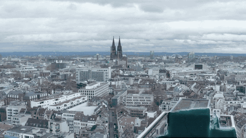
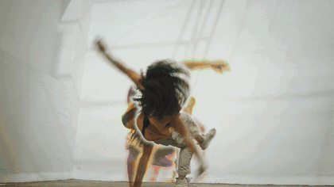
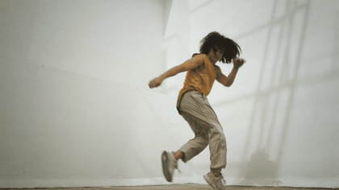
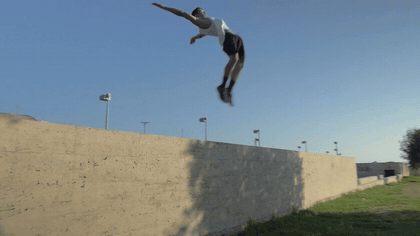
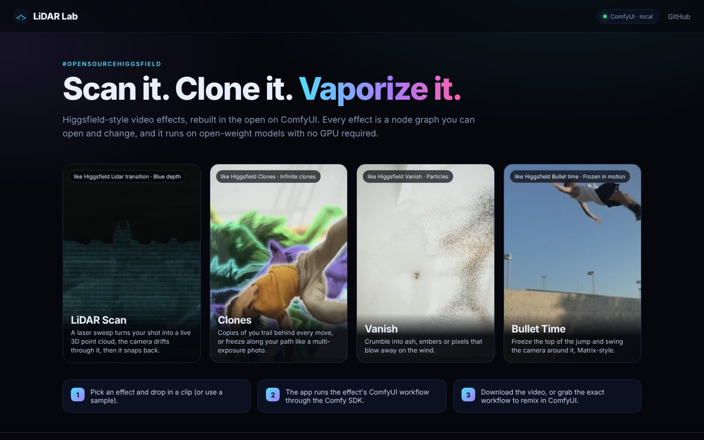
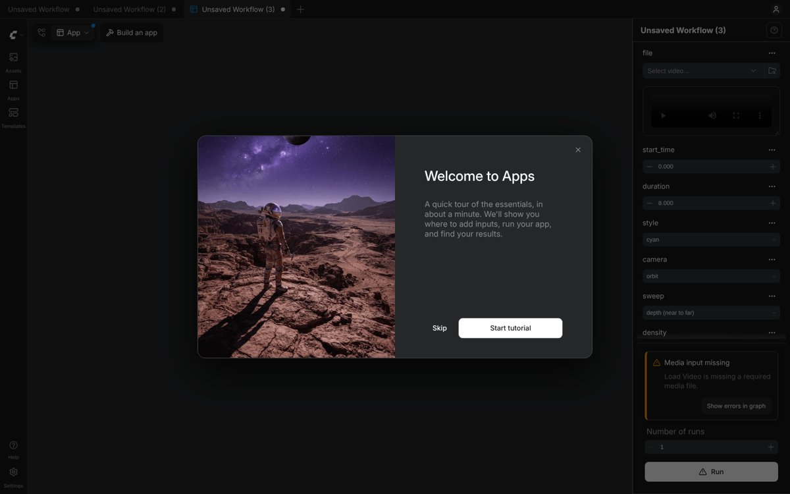

# LiDAR Lab

**Open-source Higgsfield-style video effects for ComfyUI: LiDAR scan, clones, vanish and bullet time.**
They are built from open-weight models and fast enough to run on a laptop CPU, with no GPU.

<p align="center">
  
  
  
  
</p>

Built for Comfy's [#OpenSourceHiggsfield](https://comfy.org/open-source-higgsfield) challenge.

| Effect | What it does | Higgsfield equivalent |
|---|---|---|
| **LiDAR Scan** | A laser sweep turns live footage into a glowing 3D point cloud. The camera drifts through it, then the sweep hands the shot back to video. | Lidar transition · Blue depth |
| **Clones** | Copies of the subject trail behind every move, or freeze along its path like a multi-exposure photo. Looks: natural, rainbow, ghost glow, LiDAR. | Clones · Infinite clones |
| **Vanish** | The subject crumbles into ash, embers, sparks or pixels that blow away on a curl-noise wind, revealing the empty background. | Vanish · Particles |
| **Bullet Time 2.5D** | Slows into the top of a jump, freezes it, swings the camera around the subject, then lets time run again. | Bullet time · Frozen in motion |

You can use the effects in three ways:

1. **ComfyUI nodes**: a `LiDAR Lab` node pack that plugs into ComfyUI's own Depth Anything 3, BiRefNet and video nodes.
2. **ComfyUI App Mode**: each preset ships as an `.app.json` that opens as a one-screen app inside ComfyUI.
3. **Gallery web app**: a Higgsfield-style one-click front end that runs the same workflows through the **Comfy SDK** and `comfy-api-proxy`.

<p align="center">
  
  
</p>

## What's new here

- **No video diffusion.** Every effect is built from three things: geometry (Depth Anything 3), mattes (a clean-plate difference key or BiRefNet), and a small point-cloud renderer written in plain PyTorch.
  - The results are deterministic and temporally stable.
  - They keep the full resolution of your footage.
  - They never hallucinate a new face or body.
  - You get the same output on a laptop as on a 5090.
- **CPU first.** Everything in this repo, including the demo, was built and rendered on a 4-vCPU cloud VM with no GPU.
  - Modern Xeons with AMX / AVX512-BF16 run bf16 matmuls about 5× faster than fp32 (measured: 3.6 vs 0.7 TFLOPS).
  - ComfyUI keeps CPU inference in fp32 (`should_use_bf16()` returns False on CPU). The workflows load Depth Anything 3 in bf16 instead, which makes it 3.4× faster.
  - The BiRefNet matte node autocasts to bf16, with an fp32 shim for torchvision's `deform_conv2d`, which has no bf16 CPU kernel.
- **Native ComfyUI building blocks.**
  - LiDAR Lab nodes take ComfyUI's own `DA3_GEOMETRY`, `MASK` and `IMAGE` types, so you can swap in any depth or mask source (SAM 3 tracks, BiRefNet, your own roto).
  - The nodes use the V3 node API.
  - The presets use only core nodes (Load Video, Trim Video, Depth Anything 3, Remove Background, Create/Save Video) plus the LiDAR Lab effect nodes.
- **Open weights only.** No partner nodes and no closed APIs. Depth Anything 3 is Apache-2.0, BiRefNet is MIT, and this code is Apache-2.0.

## Quick start (ComfyUI)

Requires ComfyUI **0.42+**, which ships the native Depth Anything 3 and BiRefNet nodes. App Mode needs frontend 1.41.13+.

```bash
cd ComfyUI/custom_nodes
git clone https://github.com/chinesepowered/hack-comfy lidar-lab   # no extra pip packages needed
cd ..
python custom_nodes/lidar-lab/scripts/download_models.py .          # DA3 Mono-Large (1.2 GB) + BiRefNet (0.4 GB)
python custom_nodes/lidar-lab/scripts/fetch_samples.py --comfyui .  # optional: demo clips + ComfyUI/input/lidarlab_sample.mp4
python main.py            # add --cpu on machines without a GPU
```

Then drag a workflow into ComfyUI:

| Workflow | Graph | App Mode |
|---|---|---|
| LiDAR Scan | `workflows/lidar_scan.json` | `workflows/lidar_scan.app.json` |
| Clones (tripod shot) | `workflows/clones.json` | `workflows/clones.app.json` |
| Clones (moving camera) | `workflows/clones_any_camera.json` | `workflows/clones_any_camera.app.json` |
| Vanish | `workflows/vanish.json` | `workflows/vanish.app.json` |
| Bullet Time | `workflows/bullet_time.json` | `workflows/bullet_time.app.json` |

Pick your clip in **Load Video**, set the start and length in **Trim**, and press Run. The API-format versions in `workflows/api/` are what the gallery app and `scripts/run_workflow.py` use.

## Gallery app (Comfy SDK)

```bash
pip install -r app/requirements.txt          # comfy-sdk, comfy-api-proxy, fastapi, uvicorn
python scripts/fetch_samples.py               # demo clips for the sample picker (optional)
COMFYUI_DIR=/path/to/ComfyUI ./scripts/start.sh
# -> open http://127.0.0.1:7860
```

```
browser ──▶ FastAPI app (app/server.py) ──▶ comfy-sdk ──▶ comfy-api-proxy ──▶ ComfyUI + LiDAR Lab nodes
            presets, uploads, SSE progress    Comfy API v2   (local, no key)
```

The app does the following:
- Uploads your clip as an SDK asset.
- Fills in the preset's workflow (trim and style knobs).
- Submits it and streams per-node progress to the browser.
- Hands back the video together with the exact workflow it ran, so you can remix it in ComfyUI.

To run on a hosted Comfy API deployment instead, set `COMFY_BASE_URL` and `COMFY_API_KEY`; nothing else changes.

From the command line, without the app:

```bash
python scripts/run_workflow.py workflows/api/lidar_scan.json my_clip.mp4 --set 8.style=thermal --set 8.camera="crane up"
```

## Nodes

| Node | Purpose |
|---|---|
| `LiDAR Scan` | Sweep → point cloud → camera move → sweep back. Styles: cyan, rgb, thermal, matrix, gold, custom colour. Sweeps: depth near→far / far→near, left→right, top→bottom, radial. Cameras: orbit, push and orbit, dolly in, crane up. |
| `Clones` | `trail` (copies follow the subject) or `stamp` (copies stay put). Looks: natural, rainbow, ghost glow, lidar. |
| `Vanish (Disintegrate)` | Dissolve direction, particle type (ash / embers / sparks / pixels), wind, turbulence, density, freeze. |
| `Bullet Time 2.5D` | Automatic apex detection or a fixed time, swing angle, push-in, slow-motion ramp, flash, motion blur. |
| `Stabilize Video Depth` | Removes frame-to-frame scale flicker from per-frame Depth Anything 3 video depth. |
| `Clean Plate (static camera)` | Recovers the empty background of a tripod shot as a temporal median, with matte-and-refine passes that remove a lingering subject. |
| `Subject Matte (clean plate)` | Fast subject masks for tripod shots, about 0.1–0.2 s per 720p frame on a CPU. |
| `Subject Matte (BiRefNet video)` | Masks for any camera, using ComfyUI's BiRefNet: bf16 on AMX CPUs, keyed every Nth frame. |

## How the effects work

- **LiDAR Scan**
  - DA3 depth is scale-stabilized over time.
  - Pixels are lifted to 3D with a 60° pinhole camera and sampled on LiDAR-style scanlines.
  - The points are additively splatted, and bloom is applied only to the highlights: the laser front and depth edges.
  - The sweep front travels through log-depth. During the hold the camera orbits the median depth, and the sky is dropped the way a real LiDAR would drop it.
- **Clones**
  - A clean plate is built from a temporal median, then refined with masked re-medians and a push-pull fill for pixels that were never visible.
  - A difference matte with a guided-filter edge cleans up the subject.
  - Earlier frames' subjects are composited behind the live one.
- **Vanish**
  - A dissolve field is built in subject-relative coordinates (direction plus fractal noise), so the pattern rides along with a moving subject.
  - Particles are emitted at the front and advected by a divergence-free curl-noise field plus wind, then rendered with bilinear splats.
  - Behind them, a clean plate fills in, relit to each frame's lighting.
- **Bullet Time**
  - The freeze frame is the apex of the jump, found from the masks.
  - The background comes from the clean plate or a push-pull fill, and is reflect-padded so the camera never runs out of picture.
  - The subject is a low-relief billboard, because monocular depth on a body is noisy.
  - Each frame of the orbit is a z-buffered splat render with motion blur and a push-in that keeps the subject framed.

## Performance

Measured on a 4-vCPU Intel Xeon (AMX) cloud VM with 15 GB RAM and no GPU, on 720p input.

| Step | Time |
|---|---|
| Depth Anything 3 Mono-Large | 0.49 s/frame (bf16), 1.67 s/frame (fp32) |
| Depth Anything 3 Small | 0.12 s/frame (bf16) |
| BiRefNet @ 768 | 4.7 s/frame (bf16); use stride 2–3 |
| Clean plate + subject matte | 0.1–0.2 s/frame |
| LiDAR Scan / Clones / Vanish / Bullet Time render | 0.05 / 0.05–0.2 / 0.2 / 0.45 s per frame |
| **End-to-end in ComfyUI** | LiDAR Scan, 6 s clip: **86 s** · Clones, 5 s: **44 s** · Vanish, 5 s: **60 s** · Bullet Time, 4 s, moving camera: **320 s** |

On a GPU, the same workflows run in a few seconds.

## Models

| Model | Used for | License | Source |
|---|---|---|---|
| Depth Anything 3 Mono-Large (or Small) | video depth, sky mask | Apache-2.0 | [Comfy-Org/Depth-Anything-3](https://huggingface.co/Comfy-Org/Depth-Anything-3) |
| BiRefNet | subject mattes on moving-camera shots | MIT | [Comfy-Org/BiRefNet](https://huggingface.co/Comfy-Org/BiRefNet) |

## Credits

- Demo footage: [Mixkit](https://mixkit.co) free stock video (Mixkit Stock Video Free License). It is downloaded by `scripts/fetch_samples.py` and not redistributed here. See [CREDITS.md](CREDITS.md).
- The submission video's voice-over was generated with ElevenLabs. It is only part of the demo video and is not used by the app or the workflows.

## License

Apache-2.0. See [LICENSE](LICENSE).
